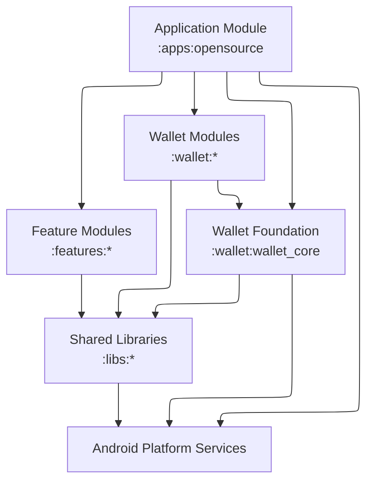

# Diia GovStack Wallet

Diia GovStack Wallet is an Android digital identity wallet built on the foundation of Ukraine's [Diia](https://diia.gov.ua/) platform. The solution is designed as a GovStack-compliant E-Wallet Building Block: a reusable, white-labeled wallet that international governments can adopt and adapt to their local context.

The project reuses Diia mobile application business logic, design system, and development approaches while focusing on digital credential issuance, storage, presentation, consent, expiry, revocation, and transaction visibility.

---

## Useful Links

| Topic | Link | Description |
|---|---|---|
| Ministry of Digital Transformation of Ukraine | https://thedigital.gov.ua/ | Official homepage of the Ministry of Digital Transformation of Ukraine |
| Diia App | https://diia.gov.ua/ | Official website of the Diia application |
| GovStack Wallet specification | https://specs.govstack.global/wallet | GovStack Wallet Building Block specification |

---

## What This Project Does

Diia GovStack Wallet provides a reusable Android foundation for a government-oriented digital identity wallet. The application is designed to let a credential holder receive, store, manage, and present digital credentials through a mobile experience built on top of Diia-inspired product and engineering patterns.

In practical terms, the project demonstrates how a white-labeled E-Wallet can be assembled as a reusable building block for different national or public-sector contexts. It combines application shell, shared platform modules, reusable user flows, and wallet-specific functionality into a single Android multi-module codebase.

---

## Functional Capabilities

| Scenario | Description |
|---|---|
| Credential issuance | Receive digital credentials from trusted issuers through wallet-initiated and issuer-initiated flows |
| Deferred credential issuance | Handle wallet flows where credentials are issued asynchronously and become available later |
| Credential management | Store, browse, inspect, and delete credentials in the wallet |
| Remote presentation | Present credentials to online verifiers in digital service flows |
| Proximity presentation | Present credentials in in-person verification scenarios |
| Privacy and consent | Review requested data, apply selective disclosure, and explicitly approve sharing |
| Credential status handling | Detect expiry, react to revocation, and prevent invalid credential use |
| Transaction visibility | Review a chronological log of wallet issuance, presentation, and credential deletion activity |

---

## Core Standards and Formats

| Standard / Format | Purpose |
|---|---|
| `OID4VCI` | Credential issuance protocol used to receive verifiable credentials from issuers |
| `OID4VP` | Presentation protocol used to share credentials with verifiers |
| `ISO/IEC 18013-5` | Standard used for mobile document presentation in proximity scenarios |
| `mDoc` | Mobile document credential format used for standards-based identity documents |
| `SD-JWT VC` | Verifiable credential format that supports selective disclosure of claims |

---

## Key Dependencies

The project combines standard Android libraries with digital identity and wallet-specific dependencies required for credential issuance, presentation, storage, and trust-sensitive mobile flows.

| Category | Libraries | Purpose |
|---|---|---|
| UI and navigation | Jetpack Compose, Material 3, AndroidX Navigation | Application UI, screen composition, and navigation flows across app, feature, and wallet modules |
| Dependency injection and background work | Hilt, WorkManager | Dependency injection, worker integration, and deferred wallet operations |
| Networking | Retrofit, OkHttp, Ktor | API integration, transport, and network communication across app and wallet flows |
| Serialization | Moshi, Gson, Kotlinx Serialization | JSON parsing and structured data exchange across app, feature, and wallet modules |
| Storage and local security | DataStore, AndroidX Security Crypto, Room | Secure local persistence, application state storage, and wallet-related transaction data |
| Wallet and identity | EUDI Wallet Core, OpenID4VCI support libraries, Bouncy Castle, CBOR support libraries | Credential issuance, wallet protocols, attestation-related flows, and identity data processing |
| Scanning and verification support | ML Kit Barcode Scanning, CameraView, ZXing | QR scanning, barcode processing, and scan-driven wallet entry points |
| Media and rich UI support | Lottie, ExoPlayer, Coil | Motion, media presentation, and richer application UI components |

---

## What This Project Contains

This repository contains:

- an Android application module that serves as the composition root;
- shared libraries for platform, UI, storage, biometrics, and scanning;
- reusable feature modules for common user flows such as login, PIN, home, and menu;
- wallet-specific modules for issuance, sharing, gallery, transaction history, and document types;
- Gradle convention plugins under `build-logic`.

---

## Current PoC Scope

Selected credential types in the current scope:

- Personal Identification Document (PID);
- International Driving License.

Selected credential formats in the current scope:

- mDoc;
- SD-JWT VC.

---

## Architecture Overview

- The repository is organized as a multi-module Android project.
- `:apps:opensource` is the application module and composition root.
- `:libs:*` modules provide shared platform, UI, storage, biometric, and scanning foundations.
- `:features:*` modules implement reusable user flows such as login, PIN, menu, context menu, and home.
- `:wallet:*` modules contain wallet-specific functionality such as issuing, sharing, gallery, transactions, and document-type logic.
- `:wallet:wallet_core` is the main wallet foundation and integration boundary for wallet-level contracts and orchestration.




---

## Project Structure

```text
wallet/
├── opensource/          # Main Android app module
├── core/                # Shared framework and platform utilities
├── ui_base/             # Shared UI foundation
├── diia_storage/        # Storage abstractions and implementations
├── biometric/           # Biometric integration
├── scanner_qr/          # QR scanning support
├── login/               # Authorization flow
├── pin/                 # PIN flow
├── menu/                # Main menu flow
├── context_menu/        # Context-menu flow
├── home/                # Home flow
├── wallet_core/         # Wallet foundation and integration boundary
├── wallet_issuing/      # Credential issuing flows
├── wallet_sharing/      # Remote and proximity presentation flows
├── wallet_gallery/      # Wallet document gallery
├── wallet_transaction/  # Transaction history
├── wallet_doc_pid/      # PID document-type support
├── wallet_doc_mdl/      # mDL document-type support
└── build-logic/         # Gradle convention plugins
```

---

## Module Map

| Gradle path | Folder | Type | Purpose |
|---|---|---|---|
| `:apps:opensource` | `opensource` | app | Main Android application module and composition root |
| `:libs:core` | `core` | library | Shared framework utilities and base contracts |
| `:libs:ui_base` | `ui_base` | library | Shared UI components and foundations |
| `:libs:diia_storage` | `diia_storage` | library | Storage abstractions and implementations |
| `:libs:biometric` | `biometric` | library | Biometric authentication support |
| `:libs:scanner_qr` | `scanner_qr` | library | QR scanning support |
| `:features:login` | `login` | feature | User authorization flow |
| `:features:pin` | `pin` | feature | PIN enrollment, unlock, and verification flow |
| `:features:menu` | `menu` | feature | Menu and profile-related flow |
| `:features:context_menu` | `context_menu` | feature | Shared context-menu flow |
| `:features:home` | `home` | feature | Main home flow |
| `:wallet:wallet_core` | `wallet_core` | wallet foundation | Wallet contracts, orchestration, and integration boundary |
| `:wallet:wallet_issuing` | `wallet_issuing` | wallet feature | Credential issuance flows |
| `:wallet:wallet_sharing` | `wallet_sharing` | wallet feature | Remote and proximity presentation flows |
| `:wallet:wallet_gallery` | `wallet_gallery` | wallet feature | Wallet document gallery and browsing |
| `:wallet:wallet_transaction` | `wallet_transaction` | wallet feature | Transaction log and history |
| `:wallet:wallet_doc_pid` | `wallet_doc_pid` | wallet document | PID-specific models and behavior |
| `:wallet:wallet_doc_mdl` | `wallet_doc_mdl` | wallet document | mDL-specific models and behavior |

---

## Requirements

The project currently assumes:

- Android Studio with modern AGP 8.x support;
- JDK 17 for Gradle/plugin execution;
- Android `compileSdk 35`, `targetSdk 35`, `minSdk 26`;
- Gradle wrapper usage via `./gradlew`;
- local Android SDK available to Android Studio and command-line builds.

Kotlin/Android convention settings are defined in `build-logic/convention`.

---

## Screen support

This application is currently designed and optimized for standard smartphone screen sizes in portrait orientation.

Please note: As this is a Proof of Concept (PoC), landscape orientation is not supported.

---

## Getting Started

1. Clone the repository.
2. Open the project in Android Studio.
3. Let Gradle sync the project and included build logic.
4. Select the `opensource` app module run configuration or build through Gradle.
5. Run the application on an emulator or physical device.

---

## Build Process

Build the main application:

```bash
./gradlew :apps:opensource:assembleGplayDebug
```

Install the main application on a connected device or emulator:

```bash
./gradlew :apps:opensource:installGplayDebug
```

Common project-wide verification commands:

```bash
./gradlew test
./gradlew lint
```

---

## Configuration

Local environment and runtime configuration may require:

- Android SDK configured for Android Studio or command-line builds;
- debug signing properties in `opensource/keys/debug.properties` when using custom debug signing;
- values from `opensource/version.properties`.

Configuration of the wallet itself is described in the [`wallet_core` module README](./wallet_core/README.md).

---

## Testing

The repository contains unit tests and static analysis configuration, but test coverage is uneven across modules. For now, treat test execution as module- and flow-dependent rather than assuming uniform coverage across the whole codebase.

Useful entry points:

- `./gradlew test`
- `./gradlew lint`

---

## Documentation

The repository is documented primarily through module-level README files and project-level contribution notes.

Useful entry points:

- [`opensource/README.md`](./opensource/README.md) - application composition root and host-module contract
- [`wallet_core/README.md`](./wallet_core/README.md) - wallet foundation, configuration, and integration boundary
- [`CONTRIBUTING.md`](./CONTRIBUTING.md) - contribution guidance and repository expectations

---

## Contributing

Contributions are welcome. Please refer to `CONTRIBUTING.md` for contribution guidelines and project expectations.

---

## Licensing

Copyright (C) Diia and all other contributors.

Licensed under the  **EUPL**  (the "License"); you may not use this file except in compliance with the License. Re-use is permitted, although not encouraged, under the EUPL, with the exception of source files that contain a different license.

You may obtain a copy of the License at  [https://joinup.ec.europa.eu/collection/eupl/eupl-text-eupl-12](https://joinup.ec.europa.eu/collection/eupl/eupl-text-eupl-12).

Questions regarding the Diia project, the License and any re-use should be directed to [modt.opensource@thedigital.gov.ua](mailto:modt.opensource@thedigital.gov.ua).
